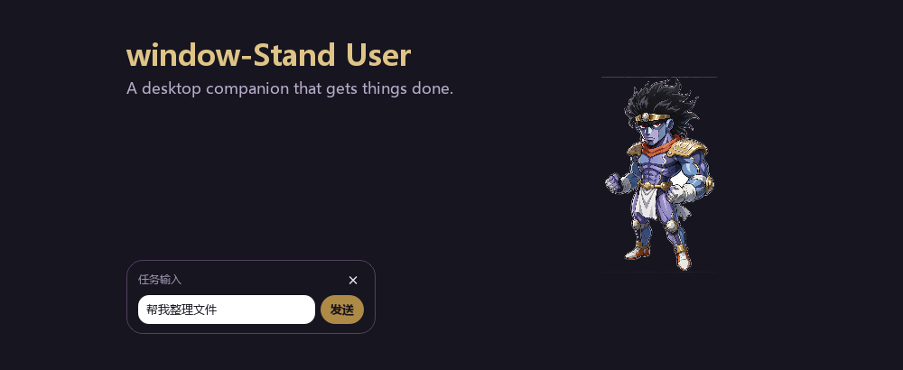
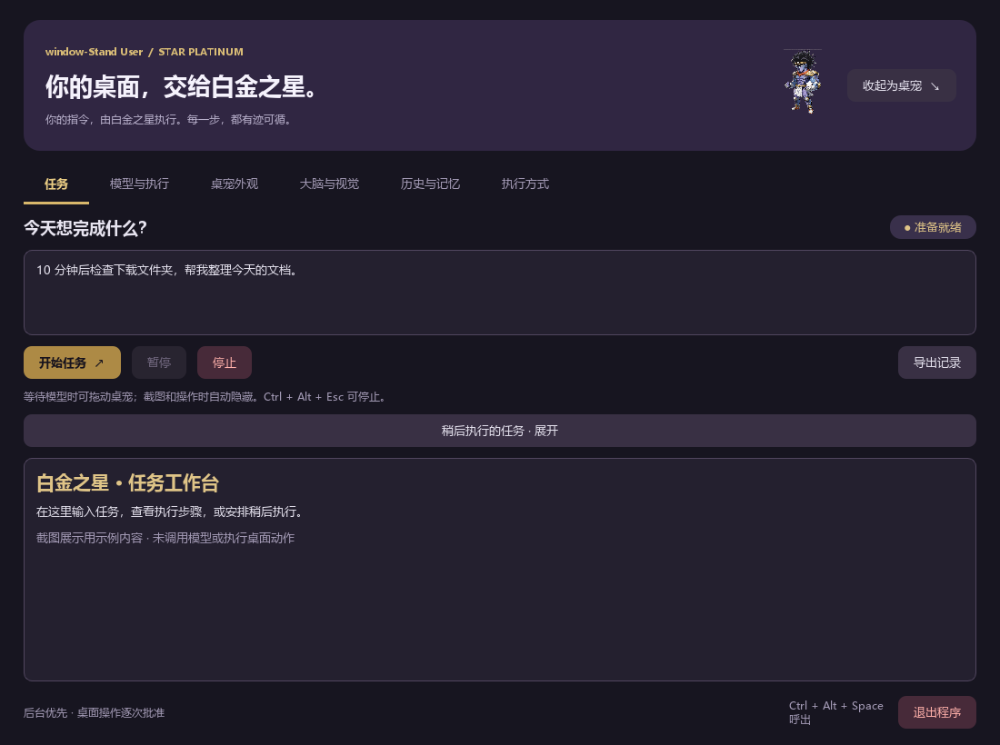
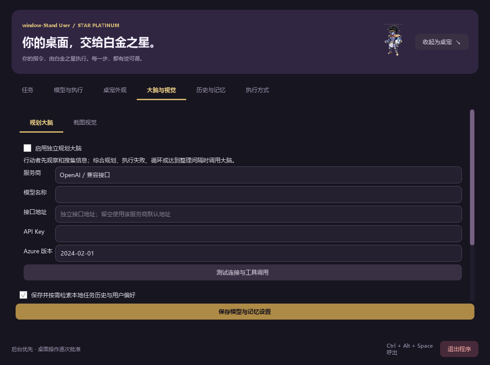
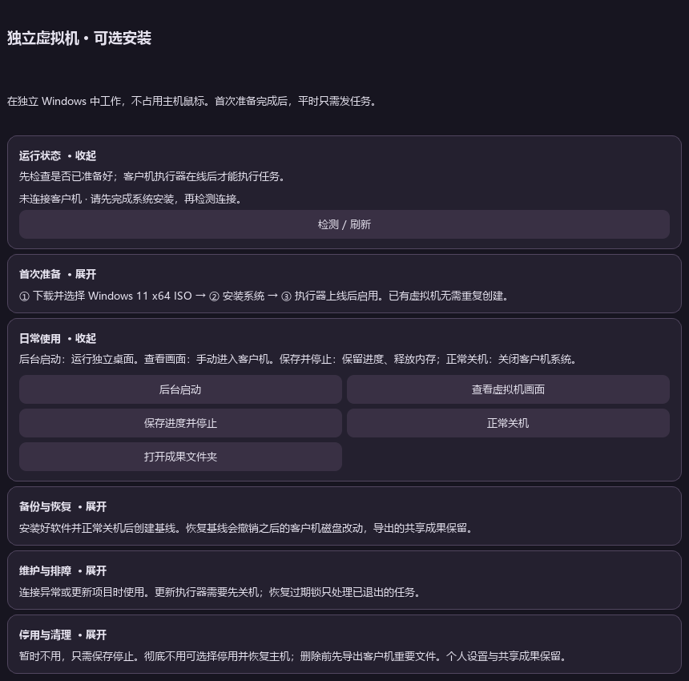
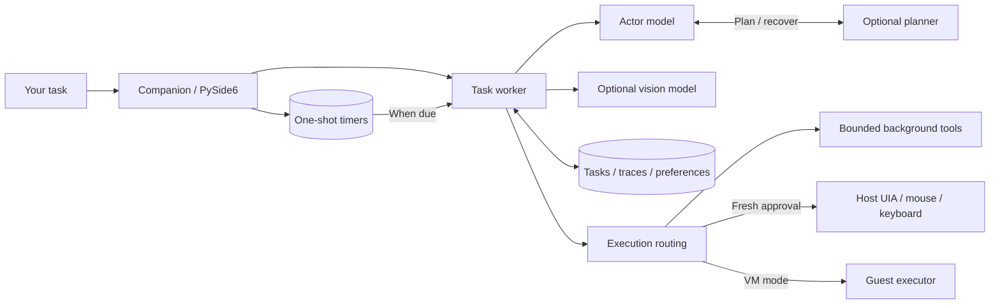

<div align="center">

# window-Stand User

**A Windows AI agent with a desktop companion of its own.**

English · [简体中文](README.zh-CN.md)


[Get started](#get-started) · [Screenshots](#screenshots) · [Architecture](#architecture) · [Documentation](#documentation)



</div>

Meet **Star Platinum / 白金之星**: a customizable desktop companion for giving a Windows agent tasks, following its progress, and controlling its actions. Built on [Windows-Use](https://github.com/CursorTouch/Windows-Use), this project adds a native desktop interface, persistent memory, separate model roles, task timers, and an optional virtual machine.

> **Active development.** The application UI is currently in Chinese. VM management and transport are implemented, but Windows guest installation and real agent execution inside the guest still need end-to-end validation.

## Features

| Feature | In practice |
| --- | --- |
| **Companion-first interaction** | Quick task input, full settings when needed, and a system-tray presence. |
| **Your own appearance** | Import images, remove white backgrounds, and use motion or state-specific artwork. |
| **Visible execution** | Follow observations, plans, action results, errors, and task history. |
| **Separate model roles** | Configure an actor, optional planner, and optional vision model with independent endpoints. |
| **Persistent memory** | Local SQLite storage for tasks, traces, preferences, and reusable workflows. |
| **Tasks with a time** | Ask for “in ten minutes” or a specific time; manage scheduled work inside the regular task page. |
| **Explicit desktop control** | Background tools avoid mouse input; host desktop actions request approval. Moving the pointer alone does not cancel approval. |
| **Optional VM execution** | Keep desktop input inside a separate Windows guest. Connection failure never falls back to host input. |

## Get started

**Requirements:** Windows x64, internet access for first-time setup, at least 5 GB of free space for the local runtime, and a model that supports tool calling. Screenshot-based use also needs a compatible vision model.

1. **Download the repository ZIP and extract it**, or clone the repository. Choose a writable local folder on the drive where you want the program and data to live.
2. **Double-click [`Start.vbs`](Start.vbs).** The first-run window prepares project-local Python and locked desktop dependencies. No preinstalled Python is needed; ZIP users do not need Git either.
3. **Configure your model** in settings: provider, model name, API key, and an optional compatible API URL. Planner and vision roles are optional.
4. **Give the companion a task.** Use quick input for everyday work and the task page for the full execution record.

Setup does not modify global `PATH`, register a global Python installation, or add a startup service. Later launches do not open a terminal. Failed setup can be retried; [`Maintenance.vbs`](Maintenance.vbs) provides repair and cleanup.

See the [installation and removal walkthrough](docs/GETTING_STARTED.md) *(Chinese)*.

### Want a separate desktop?

The VM is optional. In **执行方式 / Execution mode**, choose a Windows 11 x64 ISO from [Microsoft](https://www.microsoft.com/software-download/windows11), confirm its license, and follow the preparation controls. Existing VirtualBox installations are reused; otherwise it is installed when requested. Windows administrator approval may be required.

The default guest has **2 CPUs, 4 GB RAM, and an 80 GB dynamically allocated disk**. Prepare Windows, applications, and logins inside the guest. A host with 16 GB RAM or more is a practical starting point; available resources are checked before launch.

After the guest executor is online, enable on-demand operation. Tasks can start the VM; after an automatically started task finishes, a short grace period is followed by saving VM state and releasing running memory. Manual takeover keeps the VM running. See the [VM guide](vm/README.md) for details and validation limits.

## Screenshots

These captures use **real application widgets with fixture content**, not recordings of a completed model task. No personal settings, credentials, or private history are loaded. The banner arranges the actual pet and quick-input widgets on a presentation surface.

### One workspace for immediate and scheduled tasks



### Independent planner and vision configuration



<details>
<summary><strong>Explore the grouped virtual-machine controls</strong></summary>
<br>


Each group explains its purpose. Advanced settings and removal controls stay collapsed until needed.

</details>

## Architecture



The host keeps the companion, model connections, and memory. In VM mode, the guest supplies observations and actions through a bounded JSON protocol without receiving model credentials. UI Automation provides controls and geometry; optional screenshots complement those observations.

Timers store task descriptions and execution environments, not stale coordinates or reusable desktop approvals. When due, they follow the ordinary execution path and observe the screen again.

## Control, resources, and limits

- **Host mode shares your desktop.** Approval covers the current action; changed targets or focus may invalidate it. Stop through the UI or **Ctrl+Alt+Esc**. Not every application supports background automation.
- **Timers require the companion to be running**, including in the tray. They do not wake the computer. Work more than five minutes late is marked missed; interrupted work is not automatically replayed.
- **VM isolation has a cost.** It needs an OS image, disk space, and runtime memory. Saving state releases RAM but retains disk files. UAC, protected desktops, logins, and some applications require manual intervention.
- **Data lives alongside the checkout.** Model calls still send necessary task and observation data to the configured provider. API keys use Windows user-bound protection; copying files to another account does not migrate credentials.
- **Cleanup preserves personal data by default.** VM removal and runtime cleanup are explicit operations. Necessary VirtualBox drivers, installer records, and Windows caches cannot all live in the project folder or be guaranteed to disappear without a trace.

Read [SECURITY.md](SECURITY.md) for the scope of these controls.

## Develop

```powershell
uv sync --locked --extra desktop --extra dev
uv run python scripts/capture_readme.py
uv run pytest tests/test_timers.py tests/test_execution.py tests/test_vm.py frontend/tests
```

Windows is required for desktop and UI Automation components. Tests use mocked tools or offscreen widgets unless documented otherwise. Screenshot capture does not load saved settings or invoke a model.

| Path | Responsibility |
| --- | --- |
| `frontend/desktop_app/` | Companion, settings, task UI, process coordination |
| `windows_use/agent/` | Observation, tool registry, agent execution |
| `windows_use/cognition.py` | Actor/planner/vision coordination and recovery |
| `windows_use/memory.py`, `timers.py` | Persistent memory and scheduling |
| `windows_use/execution.py`, `safety.py` | Routing, approval, and action checks |
| `windows_use/vm/`, `vm/` | Guest transport, provisioning, lifecycle management |
| `scripts/` | Setup, maintenance, screenshot capture |

Legacy `windows_use` imports and the `.windows-use` data directory remain compatible.

## Documentation

- [中文 README](README.zh-CN.md)
- [First-run guide](docs/GETTING_STARTED.md) · [Companion guide](frontend/DESKTOP_GUIDE.md)
- [VM guide](vm/README.md) · [Cognitive architecture](docs/COGNITIVE_ARCHITECTURE.md)
- [Contributing](CONTRIBUTING.md) · [Publication contents](docs/PUBLISHING.md)
- [Upstream README](README.upstream.md)

## Acknowledgments & license

Based on [CursorTouch/Windows-Use](https://github.com/CursorTouch/Windows-Use), with upstream notices preserved. Safety work also references ARC-CUA; see the [migration notes](docs/SAFETY_MIGRATION.md) and [third-party license](docs/third-party/arc-cua-LICENSE.txt).

Code is distributed under the [MIT License](LICENSE). The Star Platinum name and artwork reference existing third-party creative work; the code license does not grant ownership of those characters or trademarks. You can supply your own companion artwork.
