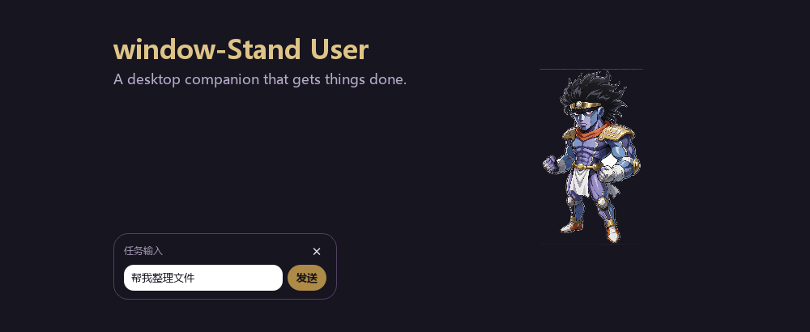
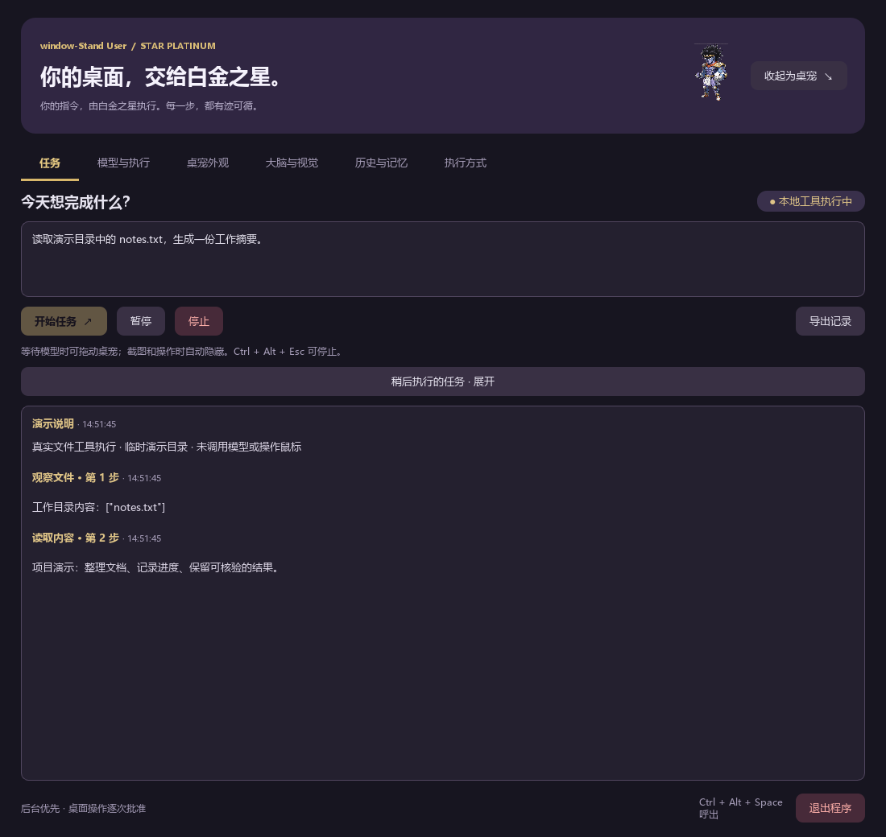
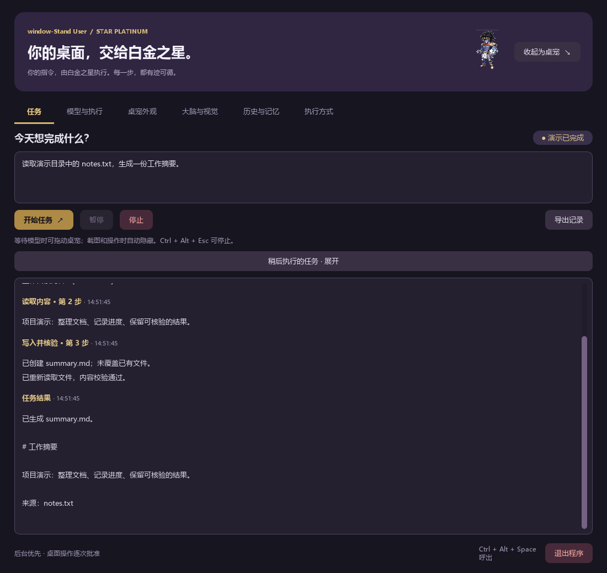
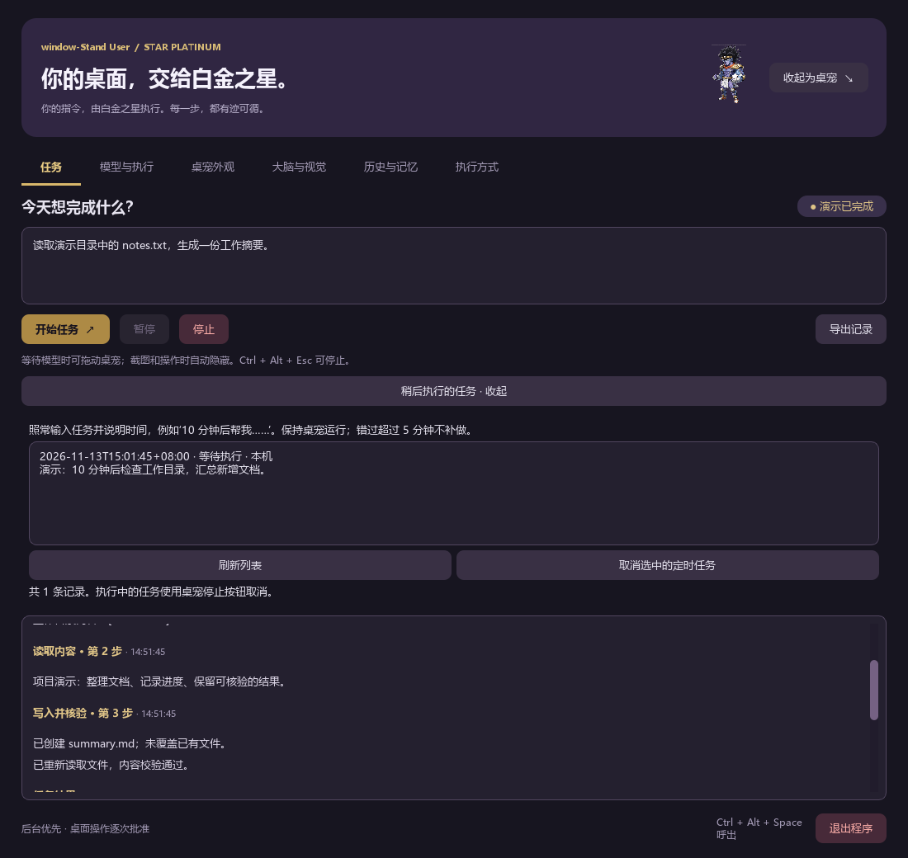
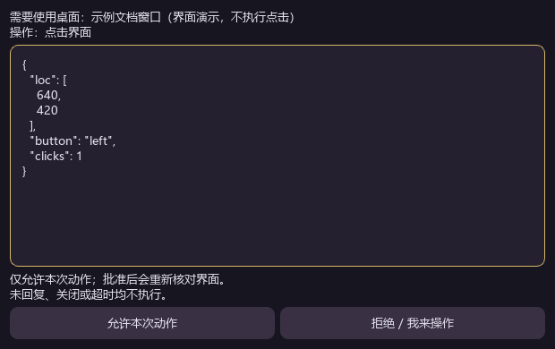
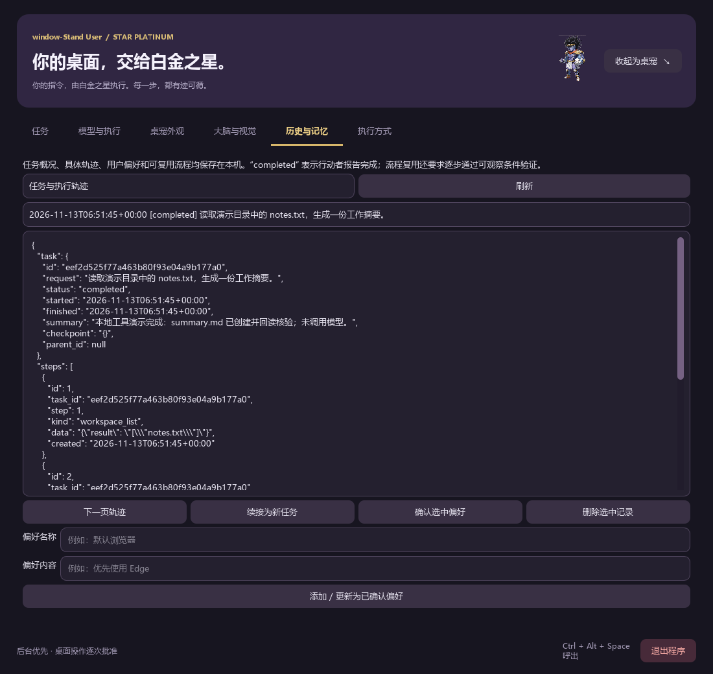
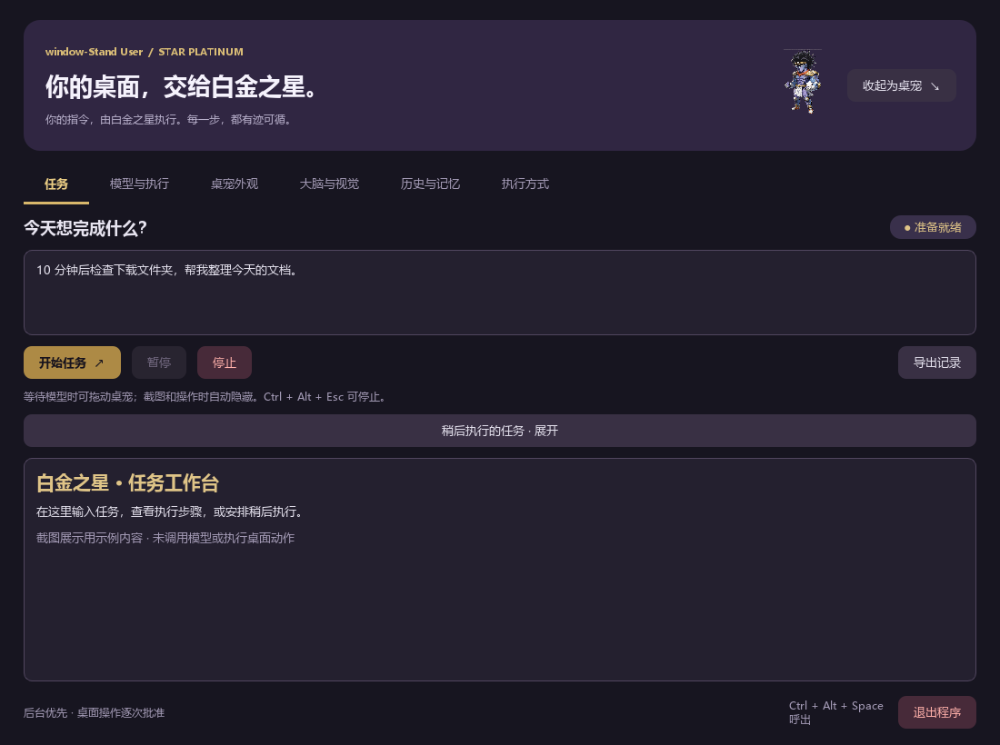
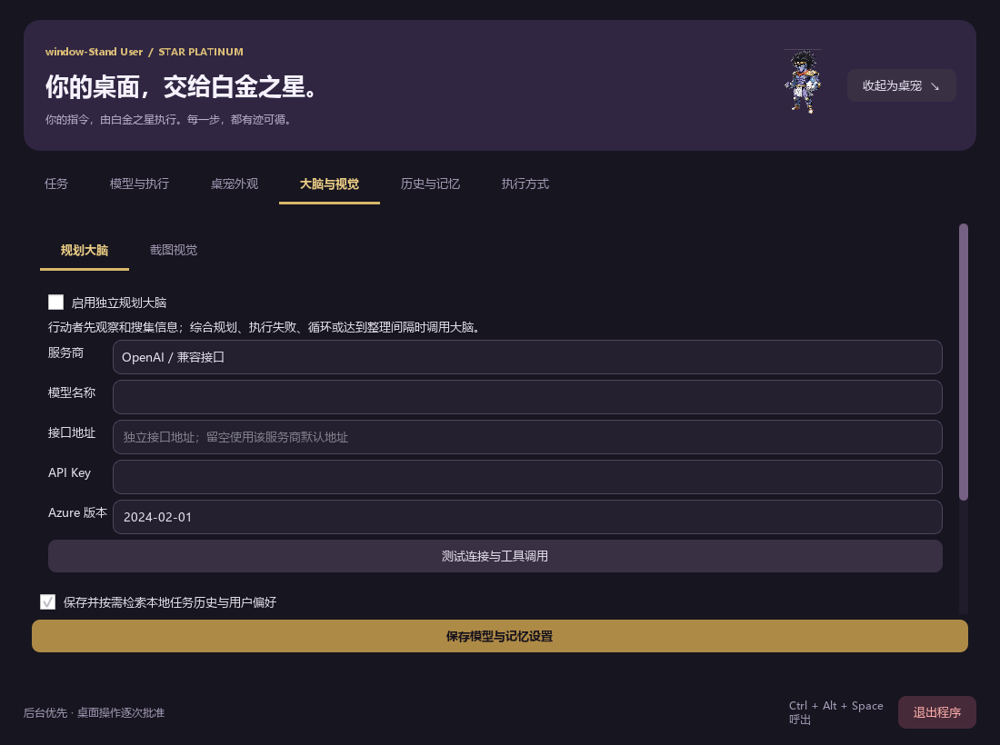
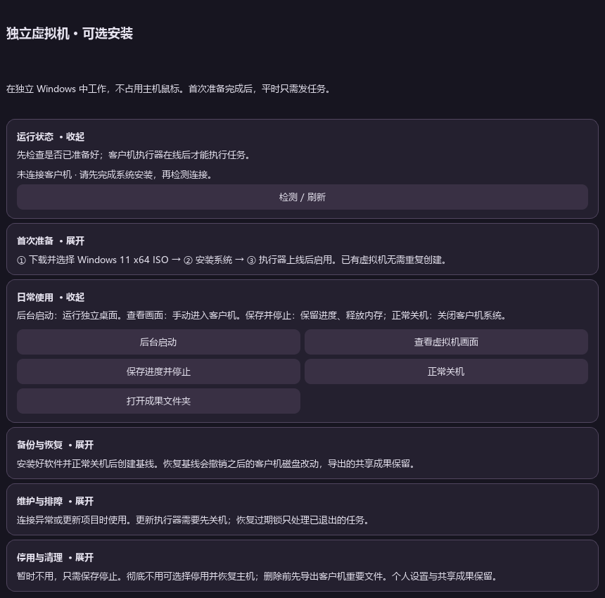
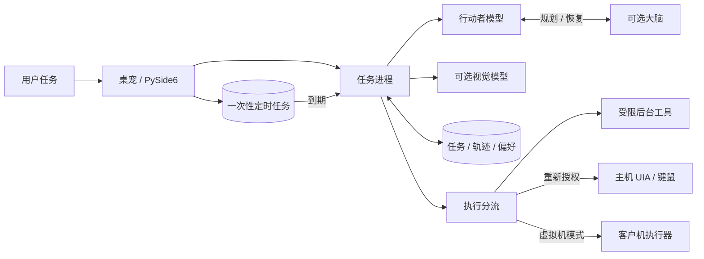

<div align="center">

# window-Stand User

**让 Windows Agent 化身桌面伙伴，把任务交给白金之星。**

[English](README.md) · 简体中文


[快速开始](#快速开始) · [界面预览](#界面预览) · [架构](#架构) · [文档](#文档)



</div>

**白金之星 / Star Platinum** 是一个可自定义外观的 Windows 桌面伙伴。直接给它任务、观察执行过程、配置模型，并控制它何时使用电脑。本项目基于 [Windows-Use](https://github.com/CursorTouch/Windows-Use) 二次开发，增加原生桌宠前端、持久记忆、多模型协作、定时执行和可选虚拟机。

> **当前持续开发中。** 产品界面目前为中文，README 默认英文并提供本中文版本。虚拟机管理与通信代码已实现，但 Windows 客户机安装和客户机内真实 Agent 操作仍待端到端验收。

## 主要功能

| 功能 | 使用方式 |
| --- | --- |
| **桌宠交互** | 快捷输入任务，需要时进入完整设置，也可隐藏到系统托盘。 |
| **自定义外观** | 导入图片、移除白底，使用动态效果或为不同状态设置形象。 |
| **可见的执行过程** | 查看观察、规划、操作结果和错误，回看任务历史。 |
| **行动者＋大脑＋视觉** | 分别配置行动模型、可选规划模型和可选视觉模型及接口。 |
| **持久记忆** | SQLite 保存任务、执行轨迹、偏好与可复用流程。 |
| **定时执行** | 在普通任务中说明“10 分钟后”或具体时间，在任务页查看和取消。 |
| **桌面授权** | 后台工具不占鼠标，主机桌面操作逐次批准；仅移动鼠标不会撤销授权。 |
| **可选独立虚拟机** | 在客户机桌面执行，连接失败不会自动改为操作主机。 |

## 快速开始

**准备条件：** Windows x64、首次安装可联网、至少 5 GB 运行环境空间，以及支持工具调用的模型接口。截图需要兼容的视觉模型。

1. **下载仓库 ZIP 并完整解压，或克隆仓库。** 放到希望保存程序和数据的本地可写目录，例如非系统盘。
2. **双击 [`Start.vbs`](Start.vbs)。** 首次向导自动准备项目专用 Python 和锁定版本依赖，不需要提前安装 Python；使用 ZIP 也无需安装 Git。
3. **填写模型配置。** 在设置中选择服务商、模型名、API Key 和可选接口地址。大脑与视觉模型按需启用。
4. **输入任务。** 平时用桌宠快捷输入，完整步骤在任务页查看。

不会修改全局 `PATH`、注册全局 Python 或添加开机服务。以后启动不弹终端，安装失败可重试。[`Maintenance.vbs`](Maintenance.vbs) 提供依赖修复、缓存和运行环境清理。

详细步骤见[从 GitHub 到开始使用](docs/GETTING_STARTED.md)。

### 想要不与主机共用鼠标？

虚拟机是可选项。在「执行方式」中选择从[微软官方下载页](https://www.microsoft.com/software-download/windows11)获取的 Windows 11 x64 ISO，确认许可后按界面步骤准备。已有 VirtualBox 时复用，没有时按需安装，Windows 可能要求管理员批准。

默认客户机为 **2 核、4 GB 内存、80 GB 动态磁盘**。Windows、应用和账号登录需要在客户机独立准备。建议从 16 GB 或以上内存的电脑开始评估，启动前仍会检查实际可用资源。

执行器上线后启用按需运行：任务可自动启动客户机，任务结束经过宽限期后保存状态、释放运行内存。手动接管的虚拟机保持运行。配置流程与验证范围见[虚拟机指南](vm/README.md)。

## 界面预览

以下截图来自**真实应用组件**。文件演示实际执行了临时工作目录的列举、读取、摘要写入和回读校验，步骤由截图脚本驱动，并非模型决策。授权和定时任务为界面示例，没有执行桌面点击或到时动作；未加载个人配置、API Key 或私人历史。

### 从观察、执行到结果，全程可见

执行时查看具体步骤，完成后检查输出。这次本地工具演示全程不移动鼠标。

<table>
<tr><th>1 · 观察目录与读取内容</th><th>2 · 写入摘要并核验结果</th></tr>
<tr><td><a href="docs/images/task-running.png"></a></td><td><a href="docs/images/task-result.png"></a></td></tr>
</table>

### 定时任务就在普通任务页中



### 操作前授权，完成后回看轨迹

<table>
<tr><th>批准一次具体桌面动作</th><th>查看持久化执行记录</th></tr>
<tr><td><a href="docs/images/desktop-approval.png"></a></td><td><a href="docs/images/task-history.png"></a></td></tr>
</table>

双列图片均可点击查看原图。页首横幅使用实际桌宠和快捷输入组件，搭配展示背景。

<details>
<summary><strong>展开查看工作台和模型设置</strong></summary>

### 普通任务与稍后执行，共用一个工作台



### 大脑与视觉模型独立配置



</details>

<details>
<summary><strong>查看按用途分组的虚拟机设置</strong></summary>
<br>


每组附有用途说明，高级设置和清理操作默认折叠。

</details>

## 架构



主机保留桌宠、模型连接和记忆；虚拟机模式通过有大小限制的 JSON 协议传递观察与动作，客户机不接收模型密钥。UI Automation 提供控件和几何信息，开启视觉后可用截图补充观察。

定时器保存任务描述与执行环境，不保存旧坐标或可复用桌面授权。到时进入普通任务执行流程，重新观察界面。

## 控制、资源与限制

- **主机模式共用桌面。** 授权仅对当前动作有效，目标或焦点变化仍可能使其失效；使用停止按钮或 **Ctrl+Alt+Esc** 中止。并非所有应用都支持后台控制。
- **定时执行要求桌宠运行**，隐藏托盘也可以；不唤醒电脑。错过超过 5 分钟标为未执行，中断任务不会自动重放。
- **虚拟机隔离有成本。** 需要镜像、磁盘和运行内存；保存状态释放 RAM，但保留磁盘文件。UAC、安全桌面、登录和部分应用可能需手动处理。
- **数据在项目目录内。** 模型调用仍会向配置的服务商发送必要任务或观察信息。API Key 使用 Windows 用户绑定保护，复制到其他账号不是凭据迁移方式。
- **清理默认保留个人数据。** 删除 VM 与清理运行环境需明确执行；必要驱动、安装记录和系统缓存不可能全部放在项目盘，也不能保证卸载后完全无痕。

具体边界见 [SECURITY.md](SECURITY.md)。

## 开发

```powershell
uv sync --locked --extra desktop --extra dev
uv run python scripts/capture_readme.py
uv run pytest tests/test_timers.py tests/test_execution.py tests/test_vm.py frontend/tests
```

桌宠和 UI Automation 组件需要 Windows。测试默认使用模拟工具或无显示界面；截图脚本使用示例数据，不读取已保存设置、不调用模型。

| 目录 | 职责 |
| --- | --- |
| `frontend/desktop_app/` | 桌宠、设置、任务界面、进程协调 |
| `windows_use/agent/` | 观察、工具注册与 Agent 执行 |
| `windows_use/cognition.py` | 行动者、大脑、视觉协调及恢复 |
| `windows_use/memory.py`、`timers.py` | 持久记忆与任务定时 |
| `windows_use/execution.py`、`safety.py` | 执行分流、授权与动作检查 |
| `windows_use/vm/`、`vm/` | 虚拟机通信、配置与管理 |
| `scripts/` | 首次准备、维护、截图生成 |

保留 `windows_use` 导入路径和 `.windows-use` 数据目录，兼容已有使用方式。

## 文档

- [English README](README.md)
- [安装、更新与卸载](docs/GETTING_STARTED.md) · [桌宠使用说明](frontend/DESKTOP_GUIDE.md)
- [虚拟机指南](vm/README.md) · [认知架构](docs/COGNITIVE_ARCHITECTURE.md)
- [参与开发](CONTRIBUTING.md) · [公开仓库内容分类](docs/PUBLISHING.md)
- [上游原始说明](README.upstream.md)

## 致谢与许可

基于 [CursorTouch/Windows-Use](https://github.com/CursorTouch/Windows-Use)，保留上游许可与版权声明。安全模块参考 ARC-CUA，见[迁移说明](docs/SAFETY_MIGRATION.md)与[第三方许可](docs/third-party/arc-cua-LICENSE.txt)。

代码使用 [MIT License](LICENSE)。白金之星名称与角色形象涉及既有第三方创作，代码许可不代表授予相关角色或商标权利；你可以替换为自己的素材。
