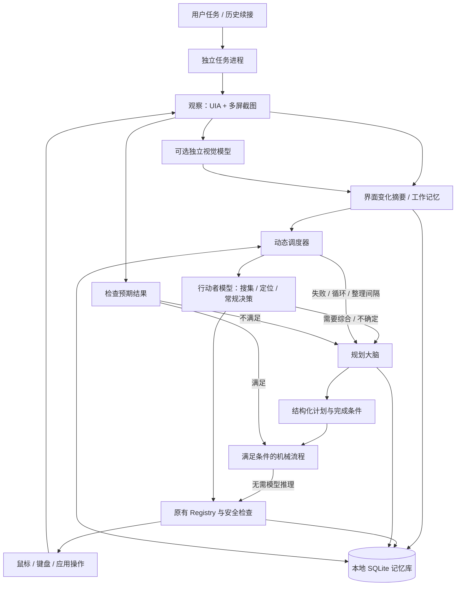

# 记忆与分层执行架构

实现日期：2026-11-10。此文描述本次已接入桌宠任务进程的实现，不把研究论文的实验成绩视为本项目的成绩。

2026-11-12：执行层已接入受限后台工具和逐次桌面动作批准，沙箱仅保留手动可选入口，见 [实现状态](HYBRID_EXECUTION_STATUS.md) 与 [完整设计](HYBRID_EXECUTION_DESIGN.md)。模型角色调度与执行域路由是两层不同职责，大脑/行动者切换不等于环境隔离。

## 1. 整体结构



三个模型角色各自配置服务商、Model ID、地址、Key。可以来自不同服务商，也可使用相同接口不同模型；调用串行发生在一个执行进程中，没有多个模型同时抢鼠标。

- **行动者**：使用原「模型与执行」配置。开局先读取桌面、检索相关历史与用户偏好；常规信息搜集和定位由它负责。
- **大脑**：在「大脑与视觉 → 规划大脑」启用。整理事实、分解目标、分析失败、制定可验证的流程，不直接调用操作工具。配置未启用时，明确请求的规划/失败恢复由行动者模型兼任。
- **视觉**：在「大脑与视觉 → 截图视觉」独立配置，并在原执行页勾选发送截图。只有视觉模型收到截图，行动者和大脑收到文字证据；未启用独立视觉时保持原来的行动者直接看图模式。关闭发送截图则不会调用视觉模型。

这是一层轻量 Python 调度器，保留原 Agent、UIA、多屏坐标、安全策略和取消机制。SQLite 使用 Python 标准库，没有新增数据库服务、Go 服务、向量库或 C 盘依赖。

## 2. 动态模型路由

| 情况 | 实际行为 |
| --- | --- |
| 新任务，尚未搜集信息 | 行动者先观察，不固定开局调用大脑 |
| 行动者认为已收集足够信息、任务抽象或需要综合 | 调用 `consult_brain`，下一次新观察后规划 |
| 工具失败、目标失效、机械流程验证失败 | 清空待执行流程，下一次观察后重规划 |
| 原 LoopGuard 发出循环警告 | 调用大脑分析，不把循环警告只当提示文字 |
| 长时间未整理信息 | 配置了大脑时，按整理间隔调用；默认 8 步 |
| 当前流程的唯一目标和前置条件满足 | 根据新 UIA 控件中心生成本步动作，不调用行动者或大脑 |
| 截图像素与显示器几何没有变化 | 复用上一次视觉描述；不重复付费识别同一画面 |
| 上下文接近窗口上限 | 大脑承担原上下文压缩；独立工作记忆仍保存计划和失败记录 |
| 较长任务结束 | 有独立大脑且预算尚有余量时，整理经验与续接线索 |

规划默认最多 6 次/任务，界面可设 1–20 次。达到上限时停止重规划，不无限重试。任务总步数限制、连续工具失败限制仍然有效。结束时的经验整理使用剩余规划额度；普通上下文压缩单独记录，并非总费用硬上限。

每次模型调用记录角色、模型名、耗时和服务商返回的 token 用量；没有捏造跨服务商费用估计。路由事件能解释为什么切换角色。旁观窗显示“视觉识别中 / 行动者思考中 / 大脑整理与规划 / 复用已验证流程”。

## 3. 记忆分层及数据表

数据库位置：`Windows-Use/.windows-use/memory.sqlite3`。启用 WAL、外键与事务，便于 GUI 读历史时任务进程继续写入。

| 层次 / 表 | 保存内容 | 使用方式 |
| --- | --- | --- |
| 工作记忆 / `tasks.checkpoint` | 当前步骤、计划、剩余动作、待验证动作、失败、近期界面变化 | 每次决策保存；进程重启后作为续接证据 |
| 任务记忆 / `tasks` | 原始请求、状态、开始结束时间、结果与经验摘要 | 开局加载少量相关任务和最近任务概况；可检索 |
| 具体执行 / `task_steps` | 观察、控件与多屏信息、动作意图、实际结果、安全拒绝、计划、角色切换、用量、验证结果 | 按任务分页，长记录另用字符游标分块读取 |
| 用户语义记忆 / `preferences` | 偏好名称、值、来源任务、原话、确认状态、更新时间 | 已确认偏好按相关性和字数预算加载；用户可编辑/删除 |
| 程序性记忆 / `workflows` | 声明式流程、来源任务、成功/失败次数、启用状态 | 相同任务与可验证起始条件满足时复用；失效自动停用 |

用户所说的“情景记忆”包含两种不同信息：某次任务发生了什么属于情景/事件记忆，稳定的个人偏好属于语义记忆。这两者分表，防止把某一次网页情况固化成用户习惯。

不是把所有历史全文塞进每次请求：

- 开局只附带少量任务概况；当前工作记忆与近期界面变化始终有界。
- `recall_history(query)`：英文词 / 中文双字片段匹配，检索近期至多 1000 个候选任务，返回少量结果。
- `read_task_history(task_id, after, limit)`：分页读取任务和轨迹摘要，返回下一页游标。
- `read_trace_entry(entry_id, offset)`：需要具体证据时，每次读取至多 12000 字符，直到 `next_offset=null`。
- `suggest_preference(name, value, source_quote)`：来源必须是当前任务中用户原话，只存为“待确认”。确认后才进入后续模型上下文，模型提议不能覆盖用户已经确认的同名偏好。

当前检索是本地词法检索，并非嵌入向量或知识图谱。这样无需增加部署组件；跨措辞语义召回仍是后续可改进项。

## 4. 机械流程复用的边界

当前实现的是**有条件的声明式点击流程**，不是任意代码生成器，也不是盲录鼠标宏。

每步包含：

```json
{
  "description": "打开结果页",
  "target": {"name": "开始", "window": "测试窗口", "control_type": "Button"},
  "expect": {"name": "结果", "window": "测试窗口", "control_type": "Button"}
}
```

运行要求：

1. 从本次新观察找到精确匹配且唯一的 `target`。
2. `expect` 在操作前必须不存在，避免拿已经存在的内容证明成功。
3. 用目标当前坐标提交到原有 Registry，执行既有权限、风险和 UIA 新鲜度检查。
4. 下一步重新观察，只有唯一 `expect` 出现才推进流程；否则停止复用、清空队列、重规划。
5. 整段逐步验证通过、最终任务报告完成后，才保存为跨任务可复用流程。跨任务只自动匹配同一任务文本及入口控件；相似任务历史可以辅助规划，不会直接套用旧动作。

最多 12 个机械点击步骤。输入动态内容、提交表单、Shell、坐标点击、跨应用复杂流程仍交给行动者决策与现有安全检查。名称变化、重复控件、网页加载较慢都可能让验证失败并退回模型；当前没有长时间自动轮询或参数化技能学习。

“动作接口返回成功”“行动者报告任务完成”“界面结果条件通过”是不同证据。数据库中的 `completed` 表示行动者报告完成，不代表已经取得全任务的独立语义证明；流程表保存的是通过界面条件验证的片段。UIA 条件仍不是服务端业务成功证明。

## 5. 本次补充的基础组件

- **界面变化记录**：原 Agent 会在操作后移除本步完整状态提示。现在维护有限长度的新增/消失控件、窗口变化及视觉描述，降低后续步骤丢失轨迹的问题。
- **动作前意图日志**：先记意图，再调用动作；崩溃时能区分“准备执行”和“获得结果”。缺少结果的动作不自动重放。
- **检查点与显式续接**：历史页“续接为新任务”会填好原任务和历史 ID，由用户发起；必须先读取记录并重新观察。不是自动恢复到崩溃时的坐标。
- **失败隔离与预算**：流程失效自动停用，规划有次数上限。取消检查贯穿模型阶段，原强制结束进程机制保留。
- **可审阅偏好**：查看、编辑、确认、删除均有 GUI，不依赖终端。删除任务会级联删除其执行记录；可复用流程是独立记录，需在流程列表单独删除。
- **角色凭证加密**：三个角色的 Key 都使用已有 Windows DPAPI；输出和记忆过滤已登记 Key。数据库仍含任务、UI 文本等个人数据，不是加密数据库；不要把 `.windows-use/` 上传到仓库。
- **视觉隔离与缓存**：独立视觉可以让行动者使用纯文本模型；不会把所有旧截图重复发给模型，截图不落库。
- **工具 schema 修复**：展开 Pydantic 的嵌套引用，使结构化规划的选择器 schema 可以被现有模型适配器传递。
- **上下文压缩修复**：正确处理数字、列表参数和空结果，避免压缩轨迹时对数字调用 `len()` 出错。
- **完成状态修复**：同步和异步循环都要求 `done_tool` 成功通过校验；不能因模型写出了工具名就把失败结果当成完成。

## 6. 文件职责与接入范围

| 文件 | 职责 |
| --- | --- |
| `windows_use/memory.py` | 纯标准库 SQLite 仓库、检索、游标读取、偏好、流程 |
| `windows_use/cognition.py` | 动态调度、规划 schema、角色调用、界面变化、流程条件验证 |
| `frontend/desktop_app/worker.py` | 创建三个模型，接入现有 Agent/Registry，记录并收尾任务 |
| `frontend/desktop_app/cognitive_ui.py` | 角色配置、历史与偏好管理 |
| `frontend/desktop_app/settings.py` | 兼容旧配置、角色校验、三个 Key 加密 |
| `frontend/desktop_app/app.py` | 路由状态显示、停止后任务收尾、启动时标记中断记录 |

本次默认接入**桌宠的同步任务路径**。原 CLI 和 `Agent.ainvoke()` 保持原有行为；`CognitiveRouter` 不是所有 Provider 流式/异步接口的替代品。若要扩展到 CLI/异步入口，应复用相同会话生命周期与新鲜观察规则，不能直接把同步适配器塞入异步执行循环。

## 7. 参考依据及取舍

- [Agent S2（2025）](https://arxiv.org/abs/2504.00906)：分离规划、执行、GUI 定位并动态修订计划。本项目借鉴角色分工，没有实现其 Mixture-of-Grounding 或复现论文成绩。
- [LangGraph Memory overview](https://docs.langchain.com/oss/python/concepts/memory)：区分会话状态与长期记忆，按语义、事件、程序性信息组织。采用这些分类与持久化思路，未引入 LangGraph 运行时。
- [Voyager（2023）](https://arxiv.org/abs/2305.16291)：技能库和基于反馈的改进。本项目采用可检索、可验证的流程库，没有迁移 Minecraft 的代码执行技能机制。
- [Reflexion（2023）](https://arxiv.org/abs/2303.11366)：保存基于反馈的经验以指导后续尝试。本项目记录失败与大脑整理结果，并明确模型反思未经独立验证，不把反思当事实。

后续扩展方向：参数化流程、针对异步页面的有界等待、可选嵌入检索、明确业务结果验证器、CLI/异步入口支持、用户设置的保存期限。虚拟机仍是原计划中的可选执行环境，不影响此次记忆与角色架构。

## 8. 验证范围

使用模拟模型与 UIA 状态验证动态路由、负坐标重新定位、流程后置条件、失败失效、历史持久化与分页、偏好确认、视觉隔离/缓存、预算及嵌套 schema；前端用离屏 Qt 验证布局和设置往返，另对真实 Windows 账号验证 DPAPI。

没有使用用户 Key 调用收费模型，也没有借验收操作真实课程或提交任何内容。实际模型的工具调用、视觉识别、规划质量和真实页面流程仍需在设置页连接测试后，用具体任务验收。
