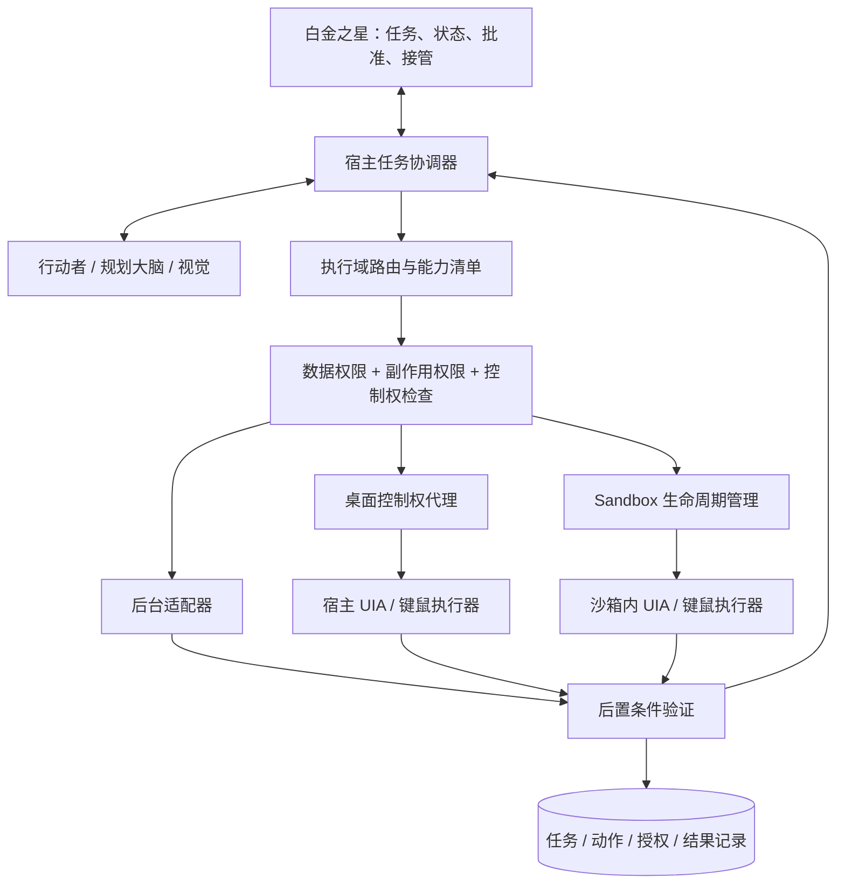

# 白金之星混合执行方案：后台、授权桌面、沙箱

最新实施路线：用户随后改选持久化独立虚拟机，当前落地 VirtualBox 后端，见 [启用与恢复指南](../vm/README.md)。下文 Sandbox 为此前候选设计，不要求用户启用，也不是当前 VM 后端。

调研与决策日期：2026-11-12。产品：window-Stand User。

**状态：轻量首版已实现，实际范围见 [实现状态与使用边界](HYBRID_EXECUTION_STATUS.md)。本文保留完整目标架构；下文未勾选的验收项不代表现有能力。**

**最新范围决定：用户提出沙箱成本高时可以不做，因此本轮不实现沙箱内 Agent、自动迁移和客户机通信。只保留按需手动启动入口，不启用 Windows 功能、不下载镜像或运行包、不创建常驻虚拟机。默认使用后台工具与逐次桌面授权。**

## 1. 产品决定

默认轻量安装，不要求 Docker、第二套 Windows 或独立浏览器镜像。采用三个执行域：

1. **后台处理**：受限文件/应用接口、独立浏览器、经过验证不会干扰输入的 UIA Pattern。
2. **授权桌面**：本机物理输入、激活窗口、可能夺取焦点的操作，执行前取得用户对明确步骤的同意。
3. **沙箱工作间**：远期可选 Windows Sandbox；沙箱内执行器属于候选扩展，本轮不实现。

这三者不是简单的“低风险到高风险”排序。必须分别判断执行位置、输入干扰、数据副作用和用户授权。后台发送消息依然会对外产生影响；沙箱修改共享文件也会影响主机。

完整持久化虚拟机降为远期可插拔后端，不作为安装前提。浏览器只是通用后台适配器之一，不将产品缩减为网页助手。

## 2. 调研事实与工程判断

| 官方事实 | 本项目的设计决定与限制 |
| --- | --- |
| UIA 提供 Invoke、Value、Toggle、Selection 等控件接口 [S1] | 优先使用能力接口，不能将存在 Pattern 等同于已证明后台安全 |
| Invoke 可以引发其他控件变化、需要用户交互或阻塞 [S2] | 未验证的 Invoke、可能弹窗或激活窗口的操作先请求桌面控制权 |
| Playwright 支持 Edge/Chrome 和独立用户数据目录 [S3][S4] | 优先复用现有 Edge，独立配置存放项目数据目录；不自动接管日常浏览器资料 |
| BrowserContext 隔离 Cookie/存储等会话数据 [S5] | 不能把浏览器上下文当作宿主进程的 OS 安全沙箱 |
| 同一交互窗口站一次只有一个活动输入桌面 [S6] | 不把 Windows 任务视图桌面或 CreateDesktop 当成通用并行鼠标方案 |
| Sandbox 使用独立内核，主机软件不会自动出现在其中，家庭版不受支持，同时只允许运行一个实例 [S7] | 支持才提供选项；不自动升级系统、安装补丁或占用用户已有沙箱 |
| Sandbox 支持目录映射、启动命令及资源配置 [S8] | 可以封装启动，但需自行准备执行器、导入文件和导出成果 |
| Sandbox CLI 用户上下文执行要求活动会话，当前不提供命令进程 I/O [S9] | 需自建通信和会话健康检查，不能假设隐藏/断开后 GUI 自动化必然可用 |
| 启用 Sandbox 要求硬件虚拟化，可能需要重启 [S10] | 环境检测只读；安装/启用作为独立、明确的用户操作 |

本机此前读到 EditionID=CoreCountrySpecific，属于家庭版；这只是当时的检测结果，发布和启动时仍须重新检测。该机应能够正常使用后台和授权桌面，而把沙箱显示为不可用并说明原因。

本文资源预算、接口和阈值均为产品设计，不是官方性能保证或本机实测结果。

## 3. 分配规则：先确定目标，再选择动作

### 3.1 路由输入

每个 ActionIntent 都包含：用户目标、语义操作、目标对象、所需数据、预期结果，以及是否必须作用于宿主机已有窗口/账号。

模型只能提出动作。执行域由确定性 Router 根据能力清单、当前观察和授权决定，不能采信模型自己声称“此动作后台安全”。

### 3.2 决策顺序

1. 验证任务范围、目标身份和数据权限；不合法则拒绝，不通过切换环境绕过。
2. 若要求隔离执行或对象为不可信可执行内容：只寻找满足要求的沙箱后端。不可用则等待用户选择，不能自动降级到本机。
3. 否则，尝试已登记且匹配当前版本的文件、文档、应用或浏览器后台能力。
4. 若只有 UIA Pattern：先做无副作用的能力探测；匹配已验证适配器才后台执行，未知副作用按需授权桌面。
5. 若需要宿主鼠标、键盘、焦点、窗口激活或可见启动：申请明确动作段的桌面控制权。
6. 若任务可迁移且预计长时间占用桌面：提供沙箱选项；检查软件/登录/数据是否可用后才能迁移。
7. 没有可行路径：暂停该步骤、保留检查点，显示缺少什么。不让模型循环试同一种方法。

### 3.3 示例分配表

| 操作 | 默认执行域 | 转换条件 |
| --- | --- | --- |
| 在用户指定目录搜索、读取、整理文件 | 后台文件适配器 | 删除、覆盖等另经副作用授权；不自动扩展到全盘 |
| 修改未打开的文档副本、生成表格/PDF | 后台格式库或应用接口 | 发现文件正在编辑或格式不支持，改用副本或请求用户选择 |
| 使用已打开的 Office/WPS 特定窗口 | 优先受支持应用接口 | 仅有键鼠路径时申请桌面授权；不承诺任何应用版本都支持 |
| 网页搜索、读取、填写表单 | 独立浏览器后台 | 登录/验证码/原生文件选择界面需人工协助或授权桌面 |
| 修改标准编辑框、切换已验证复选框 | UIA 后台适配器 | 不支持 Pattern 或存在激活副作用，返回授权请求，不调用 SendKeys 回退 |
| 微信发送、宿主窗口提交、拖拽、自绘界面 | 授权桌面 | 是否发送需满足内容/收件人授权，控制权不等于发送许可 |
| 打开不可信安装包、未知脚本 | 沙箱 | 无沙箱则阻塞或用户取消，不按“普通后台命令”执行 |
| 长时间 GUI 任务且环境可迁移 | 可选沙箱 | 不直接复制主机账号密钥，也不假定主机已安装软件可用 |
| UAC、安全桌面、密码或敏感验证 | 人工接管 | 不让 Agent 处理受保护桌面；返回后重新观察 |

“运行在后台”只表示不占用交互输入，不保证无副作用或系统隔离。

## 4. 架构与职责



保留现有 Python 核心和 PySide6 前端。本轮不引入 Go 服务、不重写整个 Agent，也不要求安装 MCP 服务才能工作。

规划大脑决定任务步骤，执行路由器决定可用手段；授权代理决定能否占用宿主输入。这三项不可合并成一段模型提示词。

### 4.1 后台适配器

- 文件：范围限定的 read/list/copy/write；临时文件后原子替换，覆盖前检查原文件指纹；识别重解析点/符号链接逃逸，防止路径检查后被替换。
- 文档：优先副本；打开中的文件不直接覆盖；输出验证文件可读性和关键内容。应用 COM/API 必须逐应用评估，可能启动可见进程或改变当前文档。
- UIA：Invoke/SetValue/Toggle/Select 等独立工具，支持与否由实际 Pattern 查询。能力探测不能偷偷执行一次点击或 SetValue。
- UIA 后台定位：使用窗口、进程、RuntimeId、控件名称和 Pattern 重新解析；不以 ControlFromPoint 校验被其他窗口遮住的后台控件。
- 浏览器：专用配置目录与页面身份；DOM 优先，截图补充。未知外部协议、系统对话框、下载后运行均不静默处理。
- Shell：不是通用后台逃生口。首版仅允许封装好的命令适配器，不向后台模式暴露任意 PowerShell；SendKeys、Win32 注入、桌面启动不能借 Shell 绕过控制权。
- 每个适配器声明 read/write/foreground/clipboard/network/process 等能力；未知副作用默认不能无授权执行。
- 即使不移动鼠标，也不能与用户同时改同一文档、同一编辑框或同一浏览器页面；使用对象锁和版本检查。锁只约束本项目，检测外部变化后暂停或重新规划。

### 4.2 能力清单

能力键至少包含：应用可执行身份、版本、控件类型、操作、前台副作用等级、验证版本。

状态为 unknown / verified_background / foreground_required / unsupported。软件更新后原验证可失效；未经验证的第三方控件不能仅凭类名进入后台白名单。

后台操作若意外激活窗口，立即停止后续操作，记录 incident 并降级该能力。副作用检测不能撤销已经发生的激活，因此未知能力必须在测试环境或取得控制权后验证。

## 5. 桌面授权：短时、明确、可撤销

### 5.1 请求内容

桌宠旁的非抢焦点通知显示：目标程序、准备做什么、为何需要桌面、最大占用时间及动作数、是否包含提交/覆盖等影响。

例：“需要在 WPS 中切换窗口并点击导出，最多 30 秒 / 5 步。期间会使用鼠标和键盘。”时间是授权上限，不是完成时间预测。

按钮：**允许这几步 / 稍后 / 我来操作**。另有明确的拒绝入口。默认不批准；关闭卡片、超时、断连、没有回复都不代表同意。

首版不提供永久“自动同意所有鼠标操作”。避免逐次点击弹窗：同一个目标、同一个目的、已展示的短动作段可共用一次授权。

### 5.2 控制权凭证

控制权是宿主授权代理持有的 lease，不是模型生成的字符串：

```text
lease_id, request_id, task_id, plan_revision, environment_id
target_process_identity, window_identity, allowed_operations
action_fingerprints, max_actions, monotonic_expiry
status: pending / granted / consumed / revoked / expired / denied
```

默认上限建议 30 秒、5 个动作，先达到者生效。到期续批不能自动延长。单次动作也需最长执行时间，不允许一个 type_tool 发送长文本绕过整个时间限制。

用户批准后，先隐藏卡片、重新观察和核对目标；恢复目标窗口本身属于授权范围。旧坐标、旧编号不得直接复用。同一目标控件可重新定位；目标、提交内容或动作目的变化，重新申请。

激活其他程序、打开未知弹窗、任务暂停、取消、进程重启、任务结束、窗口身份失效、宿主锁屏均撤销当前 lease。历史记录、工作流和配置里都不恢复“已同意”状态。

### 5.3 不与风险权限混淆

原 allowed_risks 保留作为副作用权限，但既有 system/unverified 授权不自动转换为桌面控制权。需要控制权且需要发送许可时，两个条件均须满足。

用户已经明确授权的内容不重复索要同一业务许可；桌面卡片解释新增的是输入占用。收件人、金额、发布内容发生实质变化时重新确认业务范围。

### 5.4 用户活动与停止

- 用户真实鼠标/键盘活动触发让出控制权；区分 Agent 注入事件及用户输入，不能仅用 GetLastInputInfo 就声称可靠区分。
- 全局紧急停止始终生效。取消后阻止新输入；对长文本分块检查取消，释放 Agent 持有的修饰键，不拦截用户输入。
- 不使用 BlockInput 锁死设备，不自动关闭用户程序。
- 暂停后“继续”只重新观察，不恢复过期控制权。
- 等待审批期间释放本项目对象锁/输入租约，不持续付费调用模型。用户拖动桌宠和关闭提示不算批准。

## 6. 沙箱工作间

### 6.1 可用性与启动

仅采用官方 Windows Sandbox 后端。检测返回 unsupported_edition / disabled_feature / restart_required / unavailable_session / ready 等明确原因。

不支持时隐藏自动启用开关但保留说明；尤其家庭版仍可用前两个执行域。需要隔离的任务暂停，不退回本机运行未知程序，也不引导使用非官方家庭版破解脚本。

启用 Windows 功能、系统下载、重启和必要系统配置必须有清晰单独入口。项目数据与包缓存放 F 盘，但 Windows 系统组件不承诺完全离开 C 盘。

检测 wsb CLI 的实际能力，而非只比较版本号；不支持新 CLI 时允许评估 .wsb 启动路径。不要把文档中的 CLI 支持当作本机可用证明。

Windows Sandbox 当前只支持一个运行实例 [S7]。首版只管理本项目创建的实例；已有未知实例时提示冲突，不自动复用、更改、停止用户的沙箱。

### 6.2 内部执行器与通信

宿主保留模型调用、Key、长期记忆和审批代理；客户机仅运行最小执行器，接收结构化动作并返回 UIA 状态、截图与结果。

不把整个宿主 .venv 直接映射当成可移植环境。构建精简 Python 执行包，剥离 PySide6、模型 SDK、训练或开发依赖；缓存一次，以只读方式提供。

通信原型先验证可达性：优先宿主指定虚拟接口上的短期鉴权通道，绑定明确地址，不默认监听全部网络接口；所需防火墙更改不得静默扩大访问。备用共享目录协议必须使用原子消息文件、校验、限额和序列号，不能直接把客户机路径拼接为宿主命令。

请求包含 session_nonce、task_id、environment_id、action_id、deadline、目标观察标识；返回必须对应未完成的请求。拒绝跨会话、重复或超时动作。

客户机按可能被任务中的不可信软件控制来设计：鉴权用于识别会话，不证明客户机可信。客户机不能批准宿主动作、索要宿主 Key 或扩大共享目录；回传文本只能当数据。

### 6.3 共享与账户

- 只读共享执行包与任务输入副本；可写共享仅限本次任务输出暂存目录。
- 默认关闭剪贴板、麦克风、摄像头和打印机重定向；联网是独立策略，需要网页时开启，离线文件任务可关闭。
- 网络开启不等于与宿主内网隔离；.wsb 的网络开关不是域名白名单。若任务要求严格网络边界且暂未实现，则明确拒绝该能力。
- 不共享整盘、主机用户目录或模型配置。沙箱内登录由用户完成，不能承诺跨销毁自动恢复登录状态。
- 输出文件有大小/数量限额，校验文件名、链接、目标目录；可执行文件不自动在宿主运行，文档不自动启用宏。
- UIA 截图、文本、密码字段都按现有隐私规则处理；桌面占用许可不等于允许把更多数据发给视觉模型。

### 6.4 生命周期

`unavailable → provisioning → starting → healthy → running → idle → exporting → stopping`；任意阶段可进入 failed。

任务开始前探测客户机交互会话、截图和键鼠是否工作；最小化/重连/断开/宿主锁屏后重新探测，不通过则暂停。

停止或销毁意味着内部状态可能丢失。区分查看窗口关闭、连接断开和真正停止实例，不跨版本假设三者相同。

首版单任务独占沙箱。空闲 5 分钟后提示导出与关闭；已知输出未导出、操作结果未知或有未保存状态时不自动销毁。下一项不相关任务不继承前项不可信环境，需导出后重建。

隔离任务中客户机使用虚拟键鼠不需要宿主控制权；打开/连接查看窗口若可能夺取焦点，仍属于宿主干扰操作，应预先说明或安排用户主动打开。

## 7. 执行协议与防绕过

### 7.1 结构化数据（拟新增）

```text
ActionIntent:
  action_id, task_id, semantic_operation, target_ref, args
  required_environment, required_capabilities
  precondition, expected_effect, risk_scope, idempotency_class

Observation:
  observation_id, environment_id, session_generation, timestamp
  target_identity, capabilities, content_fingerprint, focus_state

ActionOutcome:
  action_id, environment_id, dispatched
  status: verified / failed / blocked / awaiting_consent / unknown
  observed_effect, verification_evidence, error_code
```

工具函数返回成功只表示调用返回；业务成功必须有后置条件证据。未知不等于失败，不能直接重试发布、付款、删除、提交等可能已完成的动作。

UIA id、鼠标坐标、HWND 和 DOM locator 均绑定环境与观察版本；跨域迁移只传任务意图、允许的数据和业务标识，重新观察定位。

### 7.2 跨前后端事件

现有 JSON-lines 增加 `consent_requested / consent_resolved / control_acquired / control_released / environment_status / action_verified`。命令增加带 request_id 的结构化批准/拒绝消息，不能沿用仅有 command 字符串的无范围批准。

首版宿主执行器的真实输入由集中代理调用，模型工具参数不能伪造 lease。同步、异步 Registry、CLI 和所有多选/多编辑、拖拽、窗口工具须走同一拦截点；不能只在桌宠前端弹窗。

无交互 CLI 默认拒绝需要批准的动作，并返回可诊断的待批准状态；不得把没有 GUI 解释成默认同意。脚本明确授权策略另行设计。

禁用后台模式任意代码执行意味着宿主代理是策略防线而非 OS 沙箱；不能对恶意插件、同用户外部进程提供绝对隔离承诺。真正不可信代码必须进入沙箱。

### 7.3 状态机

```text
observe → propose → route → check_permissions
  → background_execute → verify
  → awaiting_consent → granted → reobserve → foreground_execute → verify → release
  → sandbox_prepare → sandbox_observe → guest_execute → verify → export

deny/defer → paused_step（保留已完成结果）
cancel/lease_expiry/user_activity → revoke → stop_new_actions → reobserve
unknown_outcome → reconcile（确认是否已发生，不盲目重放）
```

恢复时只有经当前观察验证的进度可继续；待审批记录可以展示，历史批准不可重放。

## 8. UI、配置和历史

任务旁显示执行域徽标：后台处理 / 等待你的同意 / 正在使用桌面 / 沙箱工作间 / 等待人工。

在现有“模型与执行”页新增“执行方式”：默认后台优先、桌面控制需批准；沙箱显示兼容性、启动/停止、输入输出范围和实际资源状态。不要把 PowerShell/端口/RuntimeId 放在普通任务流程中。

授权卡不自动激活窗口，用户主动点击后展开。展示目标程序、动作摘要与限额，而不是只显示“是否允许”。“拒绝”应让用户仍能导出前面已完成的结果。

设置建议字段：`execution_policy=background_first`、`foreground_consent=required`、`lease_max_seconds=30`、`lease_max_actions=5`、`sandbox_enabled=false`、`sandbox_idle_minutes=5`。

旧模型配置、Key、图片、历史原样保留。旧 allowed_risks 不迁移为控制权。新增设置保存仍按现有原子写入与读取验证执行。

SQLite 迁移拟新增：

- `execution_actions`：task/action/environment、意图指纹、路由原因、结果与幂等分类。
- `consent_requests`：动作段、范围、申请/回复时间与终态；不保存可复用有效令牌。
- `execution_environments`：实例身份、代次、生命周期、归属和输出清单。
- `capability_records`：适配器/应用版本、验证证据和失效原因。

现有 task_steps 继续保存事件以便旧历史页面读取。迁移事务化、幂等；升级前备份数据库，失败不清空旧记录。模型通过现有按需检索读取结果，授权表不能被模型直接写成 approved。

## 9. 改造文件映射

| 位置 | 工作 |
| --- | --- |
| 拟新增 `windows_use/execution/` | contracts、router、capabilities、consent、verification、sandbox 管理 |
| 拟新增 `windows_use/execution/backends/` | files、uia_patterns、browser、foreground、sandbox_guest |
| `windows_use/agent/registry/service.py` | 同步/异步统一路由、授权、目标复核与结果分类 |
| `windows_use/agent/desktop/service.py` | 真实键鼠和焦点改变经代理，后台 Pattern 与鼠标方法分开 |
| `windows_use/safety.py` | 保留风险权限，组合环境/控制权/范围判断，不以字符串匹配代替所有判断 |
| `windows_use/cognition.py` | 给模型可用能力和失败证据，审批期间停止推理，跨域重定位 |
| `windows_use/memory.py` | 新表与迁移、验证轨迹、结果未知的恢复 |
| `frontend/desktop_app/worker.py` | 审批等待可取消、命令处理、lease 生命周期与环境协议 |
| `frontend/desktop_app/process.py` | 支持结构化消息、请求身份校验、重启后旧消息作废 |
| `frontend/desktop_app/app.py`、`widgets.py` | 非抢焦点批准卡、执行域状态、人工接管 |
| `frontend/desktop_app/settings.py` | 增量配置、兼容现有角色与加密 Key |
| 拟新增 `sandbox/` | 最小执行包、启动模板、传输协议，不包含用户密钥与环境镜像 |

当前已有独立 worker、暂停取消、安全规则、控件编号、焦点验证、SQLite 历史和模型分工，可以复用；当前并无完整控制权租约、后台路由或沙箱生命周期管理，不能将上述拟新增组件标为已完成。

## 10. 资源与依赖策略

- 首版仅一个执行任务；每个环境的 GUI 动作串行。审批等待不轮询模型。
- 本机每次仅一个控制权 lease。后台文件操作按对象限制并行，UIA 不并行修改同一个应用。
- 默认截图按步骤采集，等待时停止重复截图；预览仅用户展开时启用，初始上限 2 帧/秒，按实测调整。
- Playwright 按需安装，先检测已有 Edge；不默认下载 Chromium/Firefox/WebKit 全套。安装失败不修改用户浏览器。
- Sandbox 执行包缓存一次，只读映射；系统组件安装可能占系统盘，UI 必须如实说明。
- 用户不开沙箱时不启动客户机，不常驻虚拟化执行器。不能以“内存上限”宣传为“实际内存占用”。
- 实测记录：空闲、启动、普通任务峰值内存、CPU、磁盘、启动时延、主机输入延迟；当前不填写虚构测量结果。

## 11. 实施顺序与验收

### P0：输入授权基础（先于任何后台宣传）

- [ ] ActionIntent/Outcome、执行域标识、集中真实输入代理。
- [ ] 短时 lease、用户活动撤销、暂停取消、非抢焦点审批 UI。
- [ ] 覆盖 click/type/shortcut/drag/scroll/app switch/launch/resize、批量工具、Shell 与所有入口。
- [ ] 旧授权不绕过新控制权；批准后重新观察。

退出条件：无批准、拒绝、超时和撤销后，所有入口均零次新宿主输入调用；停留在审批状态时无新增模型调用。

### P1：通用后台 MVP

- [ ] 文件/文档副本适配器、范围与并发版本验证。
- [ ] UIA Pattern 工具和已验证能力清单，失败不静默回退。
- [ ] 以至少两类非浏览器应用验证后台能力，不只验证网页。
- [ ] 独立浏览器作为补充，账号和资料目录不与用户共用。

退出条件：文件任务、标准控件编辑、网页任务分别在用户同时工作时通过；不移动宿主鼠标、不改变用户焦点或剪贴板。未知能力走审批。

### P2：沙箱原型（仅在受支持测试机）

- [ ] 可用性检测、单实例归属、最小执行包、鉴权通信、心跳。
- [ ] 客户机截图/输入、输出导出、取消、异常清理。
- [ ] 不支持版本给出准确状态；本机无需安装 Sandbox 也能通过降级测试。
- [ ] 实测后台、最小化、重连、锁屏、应用安装和软件登录边界。

退出条件：不抢宿主鼠标，客户机仅写授权输出范围，结果可核对；未知任务结果不重复提交；无未导出成果被自动销毁。

### P3：统一产品验收

- [ ] 混合任务跨域续接、实时状态、历史恢复与配置迁移。
- [ ] 暂停/拒绝后继续已有任务不重复已完成动作。
- [ ] 发布说明明确三种模式的隔离与兼容差异。
- [ ] 记录真实资源数据，按数据调整预览和空闲策略。

### 必须覆盖的回归场景

| 场景 | 预期 |
| --- | --- |
| 模型用 shell SendKeys、批量编辑、app switch 绕过授权 | 拒绝，不执行宿主输入 |
| 用户批准后移动目标窗口或切换应用 | 重新观察，目标变化使原动作失效 |
| 撤销后仍有延迟批准包、worker 重启收到旧包 | task/request/session 不匹配，拒绝 |
| 用户拖动鼠标、键入、按紧急停止 | 后续注入停止，控制权撤销 |
| UIA 支持 Pattern 但会弹窗或激活 | 未验证时先批准；发现副作用后降级能力 |
| 用户同时改文档 | 版本冲突，不覆盖用户修改 |
| 点击返回成功但没出现结果 | 标记未验证，不能 done；禁止无依据重复提交 |
| 沙箱进程断连，提交可能已发生 | 标记 unknown，恢复后先核对 |
| 沙箱不可用或主机已有非本项目沙箱 | 不抢占、不停止别人的实例、不静默回退宿主 |
| 输出文件路径穿越、链接逃逸、超大消息 | 拒绝导入，隔离该环境输出 |
| 沙箱伪造批准事件、请求宿主 Key | 消息拒绝，不授予宿主能力 |
| 导出失败、文件同名、客户机未保存 | 不覆盖主机、不自动销毁，展示恢复路径 |

## 12. 不做与待验证

首版不做：完整 Windows VM 自动安装、家庭版破解 Sandbox、RDP 多会话补丁、任意软件后台控制承诺、无授权全盘访问、全局输入屏蔽、将浏览器 Context 宣称为 OS 沙箱。

待验证：UIA 各应用版本副作用；Sandbox 会话在后台的稳定性；客户机通信与本机代理兼容性；宿主锁屏行为；用户输入与注入事件区分；大文件导出与故障恢复；实际资源占用。

## 13. 一手资料

- [S1 UIA 控件模式](https://learn.microsoft.com/en-us/windows/win32/winauto/uiauto-controlpatternsoverview)
- [S2 Invoke 行为与副作用](https://learn.microsoft.com/en-us/windows/win32/winauto/uiauto-implementinginvoke)
- [S3 Playwright 浏览器支持](https://playwright.dev/python/docs/browsers)
- [S4 独立浏览器资料目录](https://playwright.dev/python/docs/api/class-browsertype)
- [S5 BrowserContext 隔离范围](https://playwright.dev/python/docs/browser-contexts)
- [S6 Win32 活动输入桌面](https://learn.microsoft.com/en-us/windows/win32/winstation/desktops)
- [S7 Sandbox 总览与版本限制](https://learn.microsoft.com/en-us/windows/security/application-security/application-isolation/windows-sandbox/)
- [S8 Sandbox 共享与资源配置](https://learn.microsoft.com/en-us/windows/security/application-security/application-isolation/windows-sandbox/windows-sandbox-configure-using-wsb-file)
- [S9 Sandbox CLI 与会话要求](https://learn.microsoft.com/en-us/windows/security/application-security/application-isolation/windows-sandbox/windows-sandbox-cli)
- [S10 Sandbox 安装要求](https://learn.microsoft.com/en-us/windows/security/application-security/application-isolation/windows-sandbox/windows-sandbox-install)

以上资料于 2026-11-12 查阅；产品阈值、接口设计和实施排序为本项目方案，须按验收项实测。
